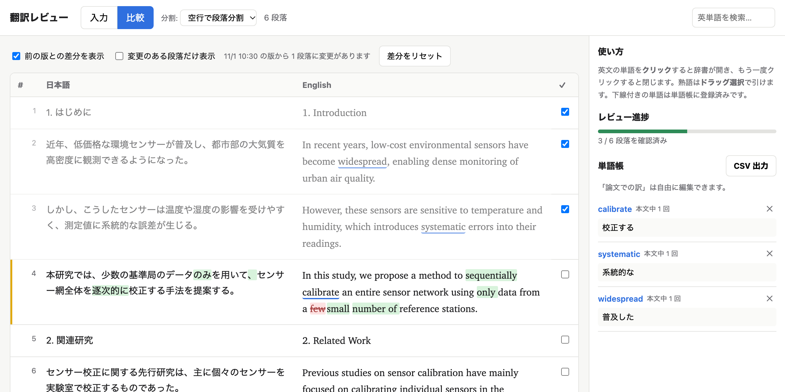
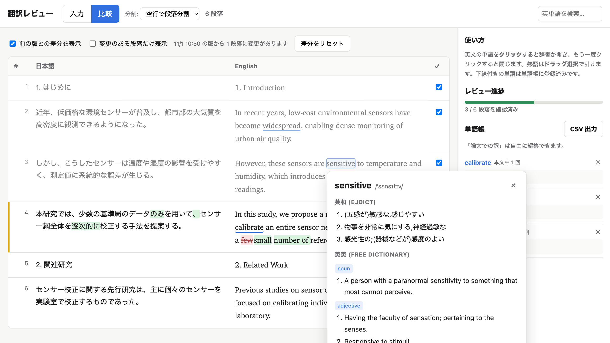

# Translation Review (translation_review.py)

[日本語](README.md) | English

A local web tool for reviewing an English translation of a Japanese paper draft, paragraph by paragraph, side by side.
It is meant for authors who translate their manuscript with an LLM or similar tool and need to check every paragraph themselves.

> The user interface is in Japanese, since the tool is aimed at authors writing in Japanese.



## Features

- **Side-by-side view** — Japanese and English paragraphs aligned row by row. Mark each paragraph as reviewed and track progress.
- **Dictionary** — Click an English word to see English–Japanese (EJDict) and English–English (Free Dictionary) definitions in a popup.
- **Word list** — Note the translation you intend for each term (e.g. calibrate → 校正する) and export it as CSV.
- **Diff against the previous version** — When you reload the drafts, additions are shown in green and deletions in red.
- **Google Docs integration** — Load drafts directly from private Google Docs (optional).
- **Paper (DOI) mode** — Enter a DOI to read that paper's English text with the same dictionary and word list.
- Runs on the Python standard library alone; only the Google Docs integration needs an extra package.



## Requirements

- Python 3.8 or later (standard library only, no `pip install` needed)
- Internet access (to download the dictionary on first launch and to query the English–English dictionary)
- For the Google Docs integration only: `google-auth-oauthlib` and an OAuth client (`credentials.json`);
  see [Loading from Google Docs](#loading-from-google-docs)

## Getting started

```bash
git clone https://github.com/harazono/translation-review.git
cd translation-review
python3 translation_review.py
```

Your browser opens `http://127.0.0.1:8000/`. Press `Ctrl+C` to stop the server.

| Option | Description |
|---|---|
| `--port 8080` | Port to listen on (default 8000; if busy, the next free port is used) |
| `--host 0.0.0.0` | Address to listen on (default `127.0.0.1`, i.e. this computer only) |
| `--no-browser` | Do not open a browser on start |

> [!WARNING]
> If you change `--host` from the default `127.0.0.1`, anyone on the same network can open the tool.
> If you are signed in for the Google Docs integration, they could read your Drive documents with your account.
> Do not change it on networks you do not trust.

On first launch, the English–Japanese dictionary EJDict (about 5 MB) is downloaded into `ejdict/` next to the script.
After that it is read from disk, so English–Japanese lookups work offline.

## Usage

1. **Input tab (入力)** — Paste the Japanese draft on the left and the English translation on the right
   (or open `.txt` / `.md` / `.tex` files). Separate paragraphs with blank lines.
   Keep the paragraph counts equal so that matching paragraphs share a row.
   You can also load the drafts from Google Docs (see below).
2. **Compare tab (比較)** — Paragraphs are shown side by side.
   - A warning appears in the header if the paragraph counts differ.
   - Switch the split mode (分割) to "1行ずつ" to pair line by line instead of by paragraph.
   - Tick the checkbox on the right to mark a paragraph as reviewed; progress is shown in the sidebar.
3. **Look up words**
   - **Click** an English word to open the dictionary; click the same word again to close it.
   - **Drag to select** a phrase (up to 6 words).
   - Or type in the search box at the top right and press Enter.
   - Inflected forms are reduced to a base form (e.g. `proposed` → `propose`, `studies` → `study`, `robustness` → `robust`).
4. **Word list (単語帳)** — Enter the translation used in your paper in the popup and add it to the word list.
   - Saved words are underlined in the text.
   - In the sidebar you can edit or delete entries and see how often each word appears. Click a word to jump to it.
   - "CSV 出力" saves `wordlist.csv` (UTF-8 with BOM, so Excel opens it correctly).

Press `Esc` to close the popup.

## Paper (DOI) mode

In the "論文 (DOI)" tab, enter a DOI (`10.1038/…` or `https://doi.org/…`) and click "英文を表示" to display the paper's English text.
As with your draft, click words to look them up and add them to the word list — handy for checking how other papers phrase things.

Only free APIs that need no registration are used, tried in this order:

| Paper | What is shown | Source |
|---|---|---|
| In PubMed Central (life sciences, some Nature papers, etc.) | Full text (published version) | [Europe PMC](https://europepmc.org/) |
| Has an arXiv version (physics, math, CS, etc.) | Full text (preprint; may differ from the published version) | HTML version on [arXiv](https://arxiv.org/) |
| Anything else (e.g. subscription papers) | Title and abstract only | [OpenAlex](https://openalex.org/) |

- Full text is never scraped from publisher websites. Use the DOI link shown to open the publisher's page.
- Math is shown as TeX in a grey box and excluded from dictionary lookup. Figures and tables are not shown.
- No Japanese translation is shown (there is no free way to provide one).

## Diff against the previous version

When reloading from Drive or opening a file changes the text, the version **just before the change** is kept as the
baseline, and the compare tab highlights what changed.

- <ins>Green</ins> marks additions and <del>red strikethrough</del> marks deletions. English is compared word by word, Japanese character by character.
- Changed paragraphs get a yellow bar next to the row number. Deleted paragraphs are shown struck through where they used to be.
- Controls above the table:
  - **前の版との差分を表示** — toggle the diff
  - **変更のある段落だけ表示** — show changed paragraphs only
  - **差分をリセット** — make the current version the baseline and clear the diff (e.g. after finishing a review)
- Reloading without changes does not overwrite the baseline.
- Paragraphs are paired using paragraphs that are exactly identical. If a paragraph is inserted and another edited at the
  same place, the pairing may shift and a whole paragraph may be shown as changed.

## Loading from Google Docs

The tool signs in with your own Google account (OAuth) and reads Google Docs that stay private.
**API keys are not used**, because an API key can only read files shared with "anyone with the link".
Access is read-only (`drive.readonly`); your documents are never modified.
No OAuth client is shipped with this repository: each user creates one in their own Google Cloud project (free).

### One-time setup

1. **Install the library**
   ```bash
   pip install google-auth-oauthlib
   ```
2. **Create a Google Cloud project** at <https://console.cloud.google.com/>.
3. **Enable the Drive API** — In "APIs & Services" → "Library", search for **Google Drive API** and click "Enable".
4. **Configure the consent screen** — In "Google Auth Platform" (formerly "OAuth consent screen"):
   - App name and support email: anything (it is for your own use)
   - Audience (user type): **External**, or **Internal** if the project belongs to your organization
   - For "External", add your own Google account under **Test users**
5. **Create an OAuth client** — "Clients" (formerly "Credentials") → "Create client" → application type **Desktop app**.
   Download the JSON, rename it to **`credentials.json`**, and put it next to `translation_review.py`.
6. (Re)start the server.

### Loading documents

1. In the input tab, paste the URLs of the Japanese and English Google Docs
   (`https://docs.google.com/document/d/…/edit`, or just the document ID).
2. Click "Drive から読み込む". The first time, a "Google にログインする" button appears: open it, sign in in the new tab,
   and grant access. Loading starts automatically once you are done.
   - For an "External" app in testing, Google shows "Google hasn't verified this app". Since you created the app yourself, choose "Continue".
3. Afterwards, use **"↻ Drive から再読み込み"** in the header to fetch the latest drafts from any tab.
   Review checkmarks stay on unchanged paragraphs; changed paragraphs are unchecked and their diff is shown.

Each paragraph in Google Docs becomes one paragraph in the tool (line breaks inside a paragraph, Shift+Enter, are kept).
Headings count as paragraphs too, so keep the Japanese and English documents structured the same way.

### Notes

- Never share `credentials.json` (your OAuth client) or `token.json` (created after you sign in).
  Both are excluded from Git by the included `.gitignore`.
- Delete `token.json` to sign in with a different account.
- For "External" apps in testing, the sign-in expires after about 7 days; you will be asked to sign in again.
- University or company Google Workspace accounts may block third-party apps.
  In that case, create the project inside your organization and choose "Internal", or ask your administrator.

## Where data is stored

The drafts, word list and review checkmarks are saved automatically in the browser's **localStorage**.

- Open the same URL (including the port) in the same browser to continue where you left off.
- A different browser or port means separate data.
- Export the word list to CSV regularly if you want to keep it.

## Dictionaries

| Type | Source | Notes |
|---|---|---|
| English–Japanese | [EJDict-hand](https://github.com/kujirahand/EJDict) (CC0 / public domain) | About 46,000 headwords, searched locally |
| English–English | [Free Dictionary API](https://dictionaryapi.dev/) | Pronunciation, examples and synonyms, queried online |
| External links | Weblio / Eijiro / Cambridge | Opened from links in the popup |

Some compounds and technical terms (e.g. `outperform`) are not in the English–Japanese dictionary. Use the English–English
definitions or the external links for those.

## Troubleshooting

- **The dictionary download fails** — Check your network and restart; only the missing files are downloaded again.
  If the python.org build of Python on macOS reports a certificate error, the tool retries with `curl` automatically.
- **The port is in use** — The next free port is used. Open the URL that is printed.
- **The English–Japanese dictionary says it is loading** — Loading takes a few seconds after start-up. Wait and search again.
- **Drive: "file not found"** — Check the URL and that the signed-in account can view the document.
- **Drive: "access_denied" or "access blocked"** — Make sure your account is listed as a test user on the consent screen.
- **Drive: "not a Google Doc"** — Convert Word files with "File → Save as Google Docs" and use that URL.

## Files

```
translation_review.py   The tool (server and page in one file)
requirements.txt        Extra package for the Google Docs integration (optional)
README.md / README.en.md
docs/                   Screenshots
ejdict/                 English–Japanese dictionary data (created on first launch)
credentials.json        OAuth client (you add it to use Drive; keep it secret)
token.json              Google sign-in (created on first sign-in; keep it secret)
```

## License

[MIT License](LICENSE)

The English–Japanese dictionary data [EJDict-hand](https://github.com/kujirahand/EJDict) (CC0) is not included in this
repository; it is downloaded on first launch. English–English definitions come from the [Free Dictionary API](https://dictionaryapi.dev/); the paper (DOI) mode uses the [OpenAlex](https://openalex.org/), [Europe PMC](https://europepmc.org/) and [arXiv](https://arxiv.org/) APIs.
