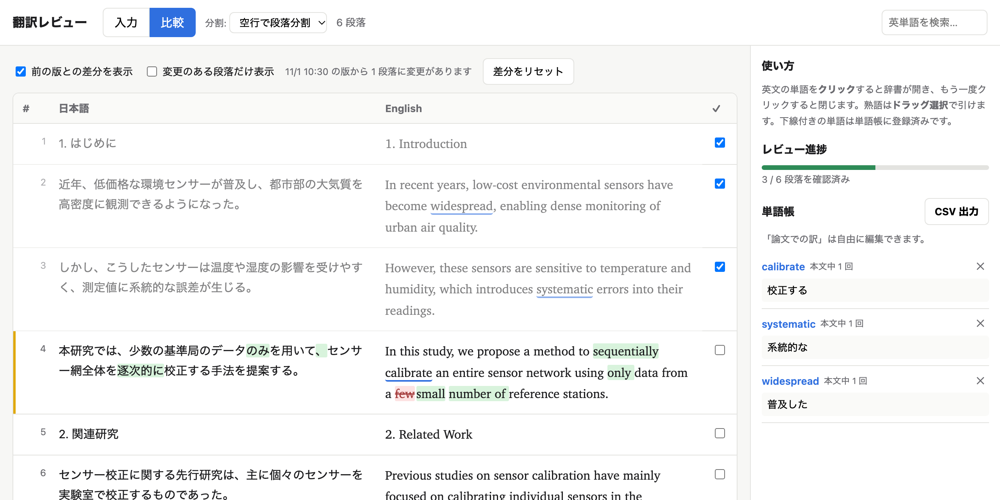
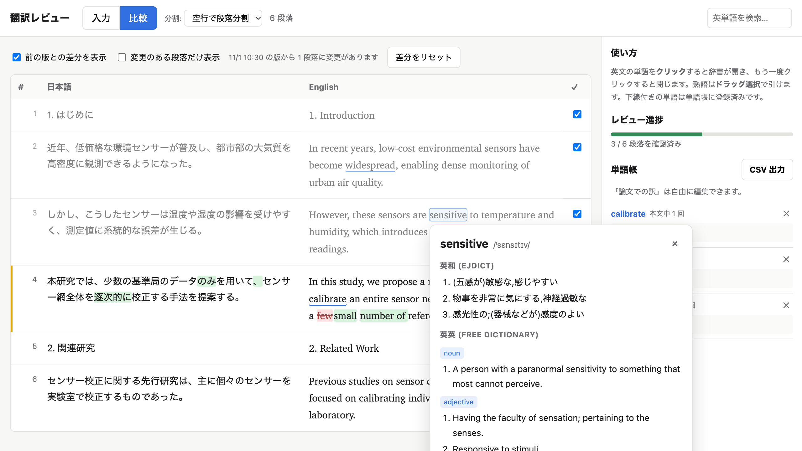

# 翻訳レビュー (translation_review.py)

日本語 | [English](README.en.md)

日本語の論文原稿とその英訳を段落ごとに左右に並べて比較・レビューするためのローカル Web ツールです。
LLM などで英訳した原稿を、著者自身が 1 段落ずつ確認する用途を想定しています。



## 主な機能

- **左右対訳表示** — 日本語原稿と英訳を段落ごとに並べて表示。段落ごとに「確認済み」をチェックして進捗を管理
- **辞書** — 英単語をクリックすると英和（EJDict）・英英（Free Dictionary）の意味をポップアップ表示
- **単語帳** — 論文で意図した訳（例: calibrate → 校正する）をメモし、CSV で書き出し
- **前の版との差分** — 原稿を読み直したときの変更箇所を、追加は緑・削除は赤で表示
- **Google ドキュメント連携** — 非公開のままの Google ドキュメントから原稿を直接読み込み（任意）
- Python 標準ライブラリだけで動作（Google 連携を使う場合のみ追加ライブラリが必要）



## 必要なもの

- Python 3.8 以上（標準ライブラリのみ。`pip install` は不要）
- インターネット接続（初回の辞書ダウンロードと英英辞書の検索に使用）
- Google ドキュメントから原稿を読み込む場合のみ: `google-auth-oauthlib` と OAuth クライアント（`credentials.json`）
  → [Google ドキュメントから読み込む](#google-ドキュメントから読み込む) を参照

## 起動

```bash
git clone https://github.com/harazono/translation-review.git
cd translation-review
python3 translation_review.py
```

ブラウザで `http://127.0.0.1:8000/` が自動的に開きます。終了は `Ctrl+C` です。

| オプション | 説明 |
|---|---|
| `--port 8080` | 使用するポート番号（既定 8000。使用中なら自動で次の番号を試します） |
| `--host 0.0.0.0` | 待ち受けるアドレス（既定 `127.0.0.1` = 自分の PC からのみアクセス可） |
| `--no-browser` | 起動時にブラウザを開かない |

> [!WARNING]
> `--host` を既定の `127.0.0.1` から変えると、同じネットワーク上の他人もこのツールを開けるようになります。
> Google ドキュメント連携でログイン済みの場合、その人があなたのアカウントで Drive のドキュメントを読めてしまうので、
> 信頼できないネットワークでは変更しないでください。

初回起動時のみ、英和辞書 EJDict（約 5MB）をスクリプトと同じフォルダの `ejdict/` にダウンロードします。
2 回目以降はこのファイルを読み込むだけなので、英和辞書はオフラインでも使えます。

## 使い方

1. **入力タブ** — 左に日本語原稿、右に英訳を貼り付けます（「ファイルを開く」で `.txt` / `.md` / `.tex` も読み込めます）。
   段落は空行で区切ってください。左右の段落数を揃えると、対応する段落が同じ行に並びます。
   Google ドキュメントの URL を入れて「Drive から読み込む」こともできます（下記）。
2. **比較タブ** — 段落ごとに左右対訳で表示されます。
   - 段落数が一致しない場合はヘッダーに警告が出ます。
   - 「分割」で「1 行ずつ」に切り替えると、改行単位で対応付けます。
   - 右端のチェックボックスで段落を「確認済み」にでき、サイドバーに進捗が表示されます。
3. **辞書を引く**
   - 英単語を **クリック** → 辞書ポップアップ（同じ単語をもう一度クリックで閉じる）
   - 熟語は **ドラッグで選択**（6 語まで）
   - 右上の検索欄に入力して Enter でも検索できます
   - 活用形は原形を推定して引きます（例: `proposed` → `propose`, `studies` → `study`, `robustness` → `robust`）
4. **単語帳** — ポップアップ下部の欄に「論文での訳」（例: robust → 頑健な）を入れて「単語帳に追加」。
   - 登録した単語は本文中に下線が付き、クリックで再表示できます。
   - サイドバーで訳の編集・削除、本文中の出現回数の確認ができます。単語名をクリックすると本文中の該当箇所へジャンプします。
   - 「CSV 出力」で `wordlist.csv`（Excel で文字化けしない BOM 付き UTF-8）を保存できます。

`Esc` キーでポップアップを閉じます。

## 前の版との差分

Drive からの再読み込みやファイルの読み込みで内容が変わると、**変わる直前の版**を比較の基準として覚えておき、
比較タブで変更箇所を色分けして表示します。

- <ins>緑</ins> が追加、<del>赤の取り消し線</del> が削除です。英語は単語単位、日本語は文字単位で比べます。
- 変更のある段落は、行番号の左に黄色い線が付きます。段落ごと削除された文章は、その位置に取り消し線付きで表示されます。
- 表の上の操作:
  - **前の版との差分を表示** — 差分表示のオン・オフ
  - **変更のある段落だけ表示** — 変更箇所だけに絞り込み
  - **差分をリセット** — 今の版を基準にして、差分の表示を消します（レビューが終わったら押す想定）
- 内容が変わらない再読み込みでは、比較の基準は上書きされません。
- 段落の対応付けは「まったく同じ段落」を手がかりにしています。同じ場所で段落の追加と書き換えが同時にあると、
  対応がずれて段落全体が変更として表示されることがあります。

## Google ドキュメントから読み込む

非公開のままの Google ドキュメントを、自分の Google アカウントでログイン（OAuth）して読み込みます。
OAuth クライアントは配布していないので、使う人がそれぞれ自分の Google Cloud プロジェクトで作成します（無料）。
**API キーは使いません**（API キーで読めるのは「リンクを知っている全員」に公開したファイルだけのため）。
権限は読み取り専用（`drive.readonly`）で、原稿を書き換えることはありません。

### 初回の準備（1 回だけ）

1. **ライブラリを入れる**
   ```bash
   pip install google-auth-oauthlib
   ```
2. **Google Cloud でプロジェクトを作る** — <https://console.cloud.google.com/> で新しいプロジェクトを作成します。
3. **Drive API を有効にする** — 「API とサービス」→「ライブラリ」で **Google Drive API** を検索して「有効にする」。
4. **OAuth 同意画面を設定する** — 「Google Auth Platform」（旧「OAuth 同意画面」）で次のように設定します。
   - アプリ名・サポートメール: 任意（自分用なので何でも可）
   - 対象（User type）: **外部**。組織アカウントで作ったプロジェクトなら **内部** も選べます
   - 「外部」の場合は **テストユーザー** に、原稿を置いている自分の Google アカウントを追加します
5. **OAuth クライアントを作る** — 「クライアント」（旧「認証情報」）→「クライアントを作成」→ アプリケーションの種類 **デスクトップ アプリ**。
   作成後に JSON をダウンロードし、名前を **`credentials.json`** に変えて `translation_review.py` と同じフォルダに置きます。
6. サーバーを（再）起動します。

### 使い方

1. 入力タブの「Google ドキュメント」欄に、日本語原稿と英訳のドキュメント URL を貼り付けます
   （`https://docs.google.com/document/d/…/edit` の形。ドキュメント ID だけでも可）。
2. 「Drive から読み込む」を押します。初回は「Google にログインする」ボタンが出るので、押して新しいタブでログインし、許可してください。
   許可が終わると元の画面で自動的に読み込みが始まります。
   - 「外部」のテストアプリでは「Google はこのアプリを確認していません」と表示されます。自分で作ったアプリなので「続行」で進めて問題ありません。
3. 以降はヘッダーの **「↻ Drive から再読み込み」** で、どのタブからでも最新の原稿を取り直せます。
   内容が変わっていない段落の「確認済み」チェックはそのまま残り、変わった段落はチェックが外れて差分が表示されます。

Google ドキュメントの 1 段落が、このツールの 1 段落になります（段落内の改行 Shift+Enter は段落内の改行として残ります）。
見出しも 1 段落として扱われるので、日英で段落の構成を揃えておくと左右がきれいに対応します。

### 注意

- `credentials.json`（OAuth クライアント）と `token.json`（ログイン後に自動作成される認証情報）は **他人に渡さないでください**。
  どちらも同梱の `.gitignore` で Git の管理対象から外してあります。
- 別のアカウントでログインし直したいときは `token.json` を削除します。
- 「外部」かつ「テスト中」のアプリでは、ログインが 7 日ほどで切れます。切れると、次の読み込み時にログイン画面がもう一度開きます。
- 大学や会社の Google Workspace アカウントでは、管理者の設定で外部アプリへのアクセスがブロックされていることがあります。
  その場合はプロジェクトを組織内で作って「内部」にするか、管理者に確認してください。

## データの保存先

入力した本文・単語帳・確認済みチェックは **ブラウザの localStorage** に自動保存されます。

- 同じブラウザで同じ URL（ポート番号を含む）を開けば続きから作業できます。
- ブラウザやポート番号を変えると別のデータになります。
- 単語帳を残したい場合は、定期的に CSV 出力しておくことをおすすめします。

## 辞書について

| 種類 | 出典 | 備考 |
|---|---|---|
| 英和 | [EJDict-hand](https://github.com/kujirahand/EJDict)（CC0 / パブリックドメイン） | 約 4.6 万見出し語。ローカルで検索 |
| 英英 | [Free Dictionary API](https://dictionaryapi.dev/) | 発音・例文・類義語。都度オンライン検索 |
| 外部リンク | Weblio / 英辞郎 / Cambridge | ポップアップ内のリンクから開きます |

`outperform` のような一部の複合語や専門用語は英和辞書に載っていないことがあります。その場合は英英辞書や外部リンクを使ってください。

## トラブルシューティング

- **辞書のダウンロードに失敗する** — ネットワークを確認して再起動してください。取得できなかったファイルだけ再ダウンロードします。
  macOS の python.org 版 Python で証明書エラーが出る場合は、自動的に `curl` で取得し直します。
- **ポートが使用中** — 自動で次のポートを使います。表示された URL を開いてください。
- **英和辞書が「読み込み中」と表示される** — 起動直後は辞書の読み込みに数秒かかります。少し待ってから再検索してください。
- **Drive:「ファイルが見つかりません」** — URL が正しいか、ログイン中のアカウントにそのドキュメントの閲覧権限があるか確認してください。
- **Drive:「access_denied」や「アクセスをブロック」** — OAuth 同意画面のテストユーザーに自分のアカウントが入っているか確認してください。
- **Drive:「Google ドキュメントではありません」** — Word ファイルなどは「ファイル → Google ドキュメントとして保存」で変換してから URL を指定してください。

## ファイル構成

```
translation_review.py   本体（サーバーと画面を 1 ファイルに同梱）
requirements.txt        Google ドキュメント連携用の追加ライブラリ（任意）
README.md / README.en.md
docs/                   スクリーンショット
ejdict/                 英和辞書データ（初回起動時に自動作成）
credentials.json        OAuth クライアント（Drive を使う場合に自分で配置。秘密）
token.json              Google ログイン情報（初回ログイン時に自動作成。秘密）
```

## ライセンス

[MIT License](LICENSE)

英和辞書データ [EJDict-hand](https://github.com/kujirahand/EJDict)（CC0）は本リポジトリには含まれず、初回起動時に取得します。
英英辞書には [Free Dictionary API](https://dictionaryapi.dev/) を利用しています。
